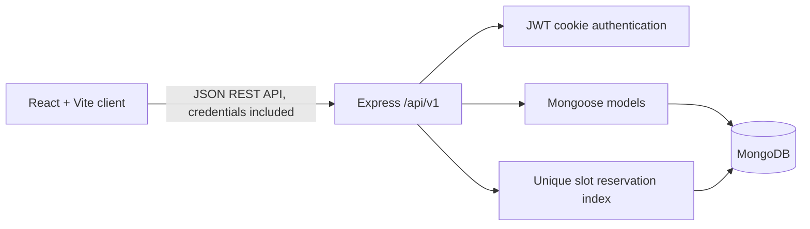

# PetCare Hub

PetCare Hub is a full-stack veterinary appointment and pet-management application for a Web Technology internal examination. It uses a React/Vite client, a Node/Express REST API, and MongoDB through Mongoose. Account data and appointments are stored by the API; the application does not substitute browser storage or sample success responses for database operations.

Veterinarian profiles seeded by this project are demonstration records, not verified medical providers. The landing-page testimonial is also clearly marked as sample content.

## Features

- Owner registration, login, logout, persistent HTTP-only cookie sessions, profile updates and password changes.
- Pet profile CRUD with server-side ownership checks and input validation.
- Veterinarian directory with fee/specialty filters and seeded demonstration profiles.
- Multi-step booking with schedule-based slots, India Standard Time, booking references and server-side availability rechecks.
- Race-safe slot reservations enforced by a MongoDB unique index; cancellation releases a reservation.
- Appointment history, search/filter, owner cancellation and rescheduling.
- Role-protected administrator dashboard, appointment status actions and veterinarian create/edit/deactivate workflow.
- Responsive layouts, keyboard-visible focus, form states, empty/error states and safe image fallbacks.

## Technology and architecture

- **Client:** React 18, React Router, Vite, custom CSS3, Lucide icons and Fetch API.
- **Server:** Node.js ES modules, Express 4, Mongoose 8, bcryptjs, JWT, HTTP-only cookies, Helmet, CORS and authentication rate limiting.
- **Database:** MongoDB. Data is persisted in MongoDB; transactions are not needed for slot uniqueness because a reservation collection enforces a unique veterinarian/date/time key.



### Folder structure

```text
client/
  src/
    api.js                 Fetch wrapper and consistent API errors
    context/AuthContext.jsx Cookie-session authentication state
    components/            Shared navigation and UI components
    App.jsx                Pages, routes and application workflows
    index.css              Design system and responsive styling
server/
  src/
    config/                Database connection and required index setup
    controllers/            Request workflows and business rules
    middleware/             Authentication and error responses
    models/                 User, Pet, Veterinarian, Appointment, SlotReservation
    routes/                 Versioned API route groups
    seed/                   Safe environment-configured demo seeding
    utils/                  Validation, async handling and slot generation
  test/                     Node test-runner checks
```

## Data model

- **User** has unique email, profile details, a password hash and an `owner` or `admin` role.
- **Pet** references its owner. Owner routes always scope reads, updates and deletes to the authenticated user.
- **Veterinarian** stores a demonstration or administrator-maintained profile, active flag, weekly local-time schedule and slot duration.
- **Appointment** references owner, pet and veterinarian; it stores a date-only UTC value, a clinic-local time, fee snapshot, reference and status.
- **SlotReservation** uniquely indexes `{ veterinarian, dateKey, startTime }`. A booking first claims the unique slot and then saves the appointment. Duplicate concurrent requests receive HTTP 409. Cancellation removes only the reservation matching that appointment and slot.

Reservations intentionally do not use MongoDB transactions, so a standalone local MongoDB server is sufficient. The API creates/verifies the required unique index when connecting; if it cannot establish that index, it will not treat the database as ready. A process interruption between reserving a slot and saving the appointment can leave a stale reservation; inspect/remove stale records as part of local development recovery. In a production system, reservation expiry/repair and transaction-capable replica-set deployment would be recommended.

## Requirements

- Node.js 20.0 or newer and npm.
- MongoDB Community Server running locally, or a MongoDB Atlas connection string.

## Install and configure

From the project root:

```powershell
npm install
npm install --prefix server
npm install --prefix client
Copy-Item .env.example server/.env
```

Edit `server/.env` and set:

```dotenv
MONGODB_URI=mongodb://127.0.0.1:27017/petcare_hub
JWT_SECRET=use-a-random-secret-with-at-least-32-characters
FRONTEND_ORIGIN=http://localhost:5173
PORT=5000
NODE_ENV=development
ADMIN_NAME=PetCare Administrator
ADMIN_EMAIL=your-admin-email@example.com
ADMIN_PASSWORD=choose-a-unique-password-of-at-least-12-characters
```

Never commit `server/.env`. The same MongoDB setting can be an Atlas URI; configure network access and a database user in Atlas, and URL-encode special characters in the database password. No MongoDB credentials belong in the client.

The default local URI uses MongoDB's standard local server. If the database is absent or unavailable, the API still starts and `/api/v1/health` returns HTTP 503 with `"status":"unavailable"` and `"database":"disconnected"`; data endpoints also respond with HTTP 503 and a setup message. The client also shows an API connection error. Start/configure MongoDB and restart the API—there is no localStorage fallback.

## Seed demonstration records

With the environment file configured:

```powershell
npm run seed
```

This idempotently upserts five clearly identified sample veterinarian profiles, each with a Monday-through-Saturday 09:00–17:00 schedule and 30-minute slots. They are seeded even when administrator credentials are not configured. To also create an administrator when one does not already exist, set `ADMIN_EMAIL` and an `ADMIN_PASSWORD` of at least 12 characters; incomplete credentials or an email belonging to an owner account cause administrator seeding to be skipped with a warning. Existing administrator accounts and credentials are left unchanged. No demo owner or appointment is created.

The server package also supports running the command directly from its folder with `npm run seed`. The root `npm run seed` command delegates to that same script.

## Run the application

Run both development servers from the project root:

```powershell
npm run dev
```

Open `http://localhost:5173`. The Vite development server proxies `/api` requests to `http://localhost:5000`.

Alternatively, run the API and UI in separate terminals:

```powershell
npm run dev --prefix server
npm run dev --prefix client
```

`client/.env.example` leaves `VITE_API_URL` blank for this Vite proxy setup. If the client should call the API directly (for example, in a deployment without the Vite proxy), set `VITE_API_URL=http://localhost:5000` in the client environment and set the server's `FRONTEND_ORIGIN` to the exact client origin.

## API reference

All endpoints are prefixed with `/api/v1`. JSON errors use `{ "message": "..." }`.

| Method | Path | Access | Purpose |
|---|---|---|---|
| GET | `/health` | Public | API and MongoDB readiness |
| POST | `/auth/register` | Public, rate-limited | Create owner account |
| POST | `/auth/login` | Public, rate-limited | Start cookie session |
| POST | `/auth/logout` | Public | Clear cookie |
| GET | `/auth/me` | Signed in | Read current account |
| PATCH | `/auth/profile` | Signed in | Update name and phone |
| PATCH | `/auth/change-password` | Signed in | Change password with current-password check |
| GET, POST | `/pets` | Signed in | List/create own pets |
| PATCH, DELETE | `/pets/:id` | Signed in | Update/remove own pet |
| GET | `/veterinarians` | Public | Search active profiles by specialty/fee |
| GET | `/veterinarians/:id` | Public | Read active profile |
| GET | `/veterinarians/:id/slots?date=YYYY-MM-DD` | Public | Read available schedule slots |
| GET, POST | `/appointments` | Signed in | List own appointments / book |
| GET | `/appointments/:id` | Owner or admin | Read authorized appointment |
| PATCH | `/appointments/:id/cancel` | Owner or admin | Cancel eligible appointment |
| PATCH | `/appointments/:id/reschedule` | Owner | Reschedule eligible appointment |
| GET | `/admin/dashboard` | Admin | Clinic counts and recent appointments |
| GET | `/admin/appointments` | Admin | Search/filter appointment list |
| PATCH | `/admin/appointments/:id/status` | Admin | Confirm, complete or cancel with transition checks |
| GET, POST | `/admin/veterinarians` | Admin | List/create veterinarian |
| PATCH | `/admin/veterinarians/:id` | Admin | Edit veterinarian |
| PATCH | `/admin/veterinarians/:id/deactivate` | Admin | Deactivate when no live appointments remain |

The appointment list accepts `status`, `from`, `to`, `page` and `limit`; page size is capped at 50. Owner appointment filters and pet ownership are enforced on the server, not just by hidden UI or route guards.

## Tests and build

```powershell
npm test
npm run build
```

Backend tests use Node's built-in test runner and cover date-key validation and appointment end-time calculations. Full registration, CRUD, authorization and concurrent-booking integration checks require a configured MongoDB instance and are not represented as passing by those unit tests.

## Security notes

- Passwords use bcrypt hashing; passwords and tokens are not stored in `localStorage`.
- JWT sessions are HTTP-only cookies. Production cookies use `Secure` and `SameSite=None` for separately hosted client/API origins; set `FRONTEND_ORIGIN` to the exact trusted client origin and serve both over HTTPS.
- CORS allows only that configured client origin; API writes reject a different browser origin.
- Authentication endpoints are rate limited, headers are hardened with Helmet, request bodies are size limited, and routes select expected fields rather than spreading arbitrary user input into models.
- Owner/admin checks, ObjectId checks, status transitions and data validation run on the server.
- This is a student MVP, not a substitute for a professional security assessment or clinic deployment. Add CSRF tokens, monitoring, backups, audit trails, stronger account recovery and operational secret management before production use.

## Troubleshooting

- **MongoDB disconnected / HTTP 503:** Check `MONGODB_URI`, start the local MongoDB service or correct Atlas network access, and restart `npm run dev --prefix server`.
- **Cannot book any time:** Run `npm run seed`; seeded schedules are Monday–Saturday, 09:00–17:00 India Standard Time. Check selected day, time and veterinarian.
- **Appointment conflict (409):** Another booking claimed the slot. Refresh availability and choose a different time.
- **Index creation fails:** Confirm the database user can create indexes and inspect existing duplicate reservation records before restarting.
- **Cookie/session does not persist:** Keep `FRONTEND_ORIGIN` exact. For production cross-origin cookies, use HTTPS and a browser configuration that permits the deployment's cookie policy.
- **Frontend cannot reach API:** Run the API on port 5000 or set `VITE_API_URL` for a separately deployed API; configure its CORS origin to the exact frontend origin.

## Limitations and future enhancements

- Demo availability uses a weekly schedule, not holidays, clinic closures or external calendar synchronization.
- No email/SMS reminders, payment processing, medical record attachments or verified clinical provider data are included.
- A stale reservation can require administrative cleanup after an abrupt process interruption during booking.
- Production extensions could add expiring reservation leases, audit logging, appointment notifications, calendar integrations, richer analytics and accessibility/usability testing with clinic users.
